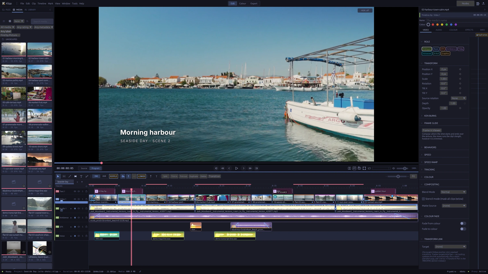

<h1>
  <picture>
    <source media="(prefers-color-scheme: dark)" srcset="assets/branding/klipp-refined/klipp-logo.svg">
    
  </picture>
</h1>

**A native video editor for Linux.**

[Website](https://davidkodar.github.io/klipp/) · [Download 0.1.0-rc.2](https://github.com/davidkodar/klipp/releases/tag/v0.1.0-rc.2) · [Discussions](https://github.com/davidkodar/klipp/discussions)

Edit on a magnetic timeline, grade in scene-linear colour, and automate workflows with local AI tools and an MCP-compatible assistant.

**Pre-release · Vulkan GPU required · Arch package or source · GPL-3.0-only**

Klipp is under active development. Expect rough edges and breaking changes; broad plugin compatibility, reliability hardening, and AMD/Intel GPU validation are ongoing. The latest release candidate, [0.1.0-rc.2](https://github.com/davidkodar/klipp/releases/tag/v0.1.0-rc.2), is out as an unsigned Arch package; there are no stability guarantees yet.

[](website/assets/edit.webp)

[Colour page](website/assets/colour.webp) · [Titles](website/assets/titles.webp) · [Sound](website/assets/sound.webp) · [Edit by transcript](website/assets/transcript.webp) · [Showcase film](https://davidkodar.github.io/klipp/#demo) · [Media credits](website/CREDITS.md)

*Klipp* is Swedish for “cut”.

## Create, finish, deliver

- **Edit:** magnetic multitrack editing, ripple and insert edits, synced multicam, a selects timeline, transitions, speed ramps and optical-flow slow motion, a curve editor for keyframes, and transcript-based cuts.
- **Picture:** one node graph per clip for effects, mattes, keys, transforms, LUTs and OFX/frei0r plug-ins, composited on the GPU.
- **Grade:** a scene-linear ACEScg pipeline, camera-log decoding, colour wheels and curves, RGB and 3D qualifiers, a grade library shared across projects, GPU scopes, and SDR/HDR delivery including HDR10+.
- **Titles:** OpenType text with complex scripts, vertical text, variable and colour fonts, animators and per-glyph motions, extruded 3D text, rolling credits, and a template library.
- **Mix:** multitrack audio with recorded track automation, EQ and dynamics, voice isolation, loudness and true-peak delivery, and dual-system sound sync.
- **Captions:** SRT, VTT, ASS, IMSC/TTML, SCC and EBU-STL in and out, captions embedded as CEA-608, and on-device translation.
- **Automate:** analyse footage, propose an edit plan, assemble a sequence, check it, and export through the control socket and an MCP server with over 120 tools.
- **Exchange:** move an edit to and from other editors as OTIO, FCPXML, EDL or AAF (through OpenTimelineIO), import FCP7 XML and MLT, and export Kdenlive. The edit comes across (clips, cuts and timing, and markers where the format has them); grades, most effects and most titles don't, and every import lists what it carried and what it left out. Your own work is saved as a `.klipp` project.

Explore the [feature reference](docs/project-reference.md#features) and [user guide](docs/src/SUMMARY.md).

## How it is built and tested

Klipp is written in Rust as a 42-crate workspace. Pictures are processed on the GPU through Vulkan, with a CPU path kept as a reference to check the GPU against. [ARCHITECTURE.md](ARCHITECTURE.md) maps the crates, the threading model, the main subsystems, and where things tend to break.

- **Over 8,000 automated tests** across 39 crates; run one crate's with `cargo test -p <crate>`.
- **CPU/GPU parity tests** render the same frames both ways and compare the pixels, for effects, transitions, keys, grades and the compositor.
- **A golden corpus** of small projects is drawn through every render path and compared.
- **Colour is checked against independent references:** the ACES 1.3 output transforms against OpenColorIO, and the camera log curves against OpenColorIO and colour-science across all 1024 10-bit code values.
- **The release package** is built and test-installed in clean Arch containers.

## Try Klipp

The primary target is **x86_64 Arch Linux / Omarchy with a working Vulkan driver**. A Vulkan 1.1 GPU is required; integrated GPUs are supported in principle, with broader hardware validation ongoing. Other distributions are less tested.

To install the release candidate, download `klipp-0.1.0rc.2-1-x86_64.pkg.tar.zst` and `SHA256SUMS` from the [release page](https://github.com/davidkodar/klipp/releases/tag/v0.1.0-rc.2), then:

```bash
sha256sum -c --ignore-missing SHA256SUMS
sudo pacman -U klipp-0.1.0rc.2-1-x86_64.pkg.tar.zst
```

To build the latest code from source instead:

```bash
sudo pacman -Syu --needed base-devel git
git clone https://github.com/davidkodar/klipp.git
cd klipp/packaging
makepkg -si
klipp
```

Run `makepkg` as your normal user. If prompted for an ONNX Runtime provider, choose `onnxruntime-cpu` for the standard setup; NVIDIA/CUDA acceleration is optional. The first build needs substantial time and disk space. AI models download on demand.

See the [installation guide](packaging/README.md) for driver checks, updates, removal, and troubleshooting. For development and other distributions, see [Building](docs/project-reference.md#building).

## Local AI and external assistants

Klipp’s built-in transcription, vision, narration, and speech-enhancement models run on your machine. Models download when needed, and AI features can be disabled in Preferences.

The `klipp-mcp` server lets an external assistant work with a running Klipp instance. **That assistant may use a local or cloud model**, depending on your MCP client and its settings. Connecting an external assistant is separate from Klipp’s local inference.

Read about the [assistant workflow](docs/project-reference.md#the-ai-assistant), [models and licences](docs/src/ai-tools/models.md), and [optional online sound libraries](docs/project-reference.md#online-sound-libraries).

## Plugins

| Use | Formats |
| --- | --- |
| Video effects | OFX 1.5, frei0r filters |
| Audio effects | LADSPA, LV2, CLAP |

Compatibility depends on the plugin and the host features it requires. These hosts implement subsets of the formats; broad automated compatibility testing is in progress. VST2 and VST3 are not supported.

## Documentation and development

- [Quick start](docs/src/getting-started/quick-start.md)
- [User guide](docs/src/SUMMARY.md)
- [Build instructions](docs/project-reference.md#building)
- [Architecture](ARCHITECTURE.md)
- [Detailed features and credits](docs/project-reference.md)

The documentation is an mdBook: run `mdbook serve docs --open` to read it locally.

Questions, help and ideas belong in [Discussions](https://github.com/davidkodar/klipp/discussions); issues are for bugs. Issues and pull requests are welcome. Read [CONTRIBUTING.md](CONTRIBUTING.md) and [CODE_OF_CONDUCT.md](CODE_OF_CONDUCT.md). Open an issue before non-trivial work and sign off commits under your own name. `scripts/install-hooks.sh` installs a pre-push hook that checks sign-offs and runs clippy and the affected crates' tests on your machine; GPU tests need a working GPU to mean anything.

Report security concerns through [SECURITY.md](SECURITY.md).

## Licence and credits

Klipp is licensed under [GPL-3.0-only](LICENSE). Bundled assets and downloaded models retain their respective licences; see [third-party credits](docs/project-reference.md#bundled-assets--third-party-credits) and [model licences](docs/project-reference.md#ai-models).
